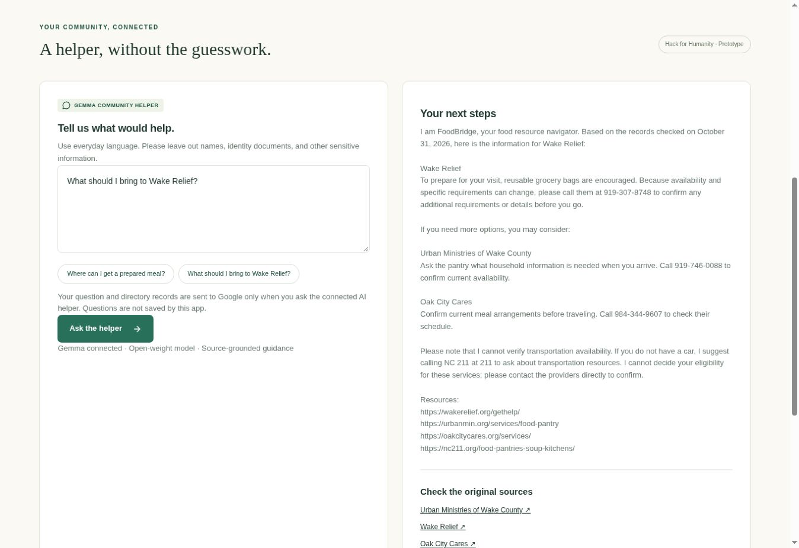

# FoodBridge Triangle 🌿

A Hack for Humanity prototype helping Raleigh / Wake County residents find food resources, understand published access requirements, and plan their next step.

## Try the demo

https://foodbridge-triangle-ben.wintrytitan1025.chatgpt.site

Open Find food, Support guide, or Community helper. The live helper uses Google-hosted `gemma-4-26b-a4b-it`; this is Gemma, not a Gemini model. No sign-in is required for the public demo.

## For judges

See [SUBMISSION.md](SUBMISSION.md) for the project story, model details, known limits, and a 90-second demo. The source ZIP contains the full application; no API keys are included.



## Features
- Sourced directory of four physical food services and three referral/benefit resources.
- Search by resource name or listed address; category filters and selected-location map.
- Browser-local saved resource plan with print support.
- Deterministic support guide with service-area and transportation questions.
- Gemma 4 helper grounded in the curated records; explicit disconnected/error states.
- Mobile-friendly, keyboard-accessible interface. No applicant accounts or identity documents.

## Source package

The complete source is in `FoodBridge-source.zip` in the GitHub repository. Download and extract it into an empty folder before running the commands below. The top-level LICENSE applies to the application code; third-party notices remain in the package.

## Run locally
Requires Node 22.13 or later. Prefer the included pnpm lockfile for reproducible installs (`corepack pnpm install --frozen-lockfile`), or use npm for a convenience install.

```sh
npm install
npm run dev
```

To enable AI, configure a server environment variable `GEMMA_API_KEY` with a Google AI Studio key. Optional: `GEMMA_MODEL=gemma-4-26b-a4b-it`. Do not use NEXT_PUBLIC_ for secrets or commit keys. Local environment files are ignored. For local development, export GEMMA_API_KEY in the terminal before starting the app (PowerShell: `$env:GEMMA_API_KEY="your-key"`; macOS/Linux: `export GEMMA_API_KEY="your-key"`). Restart the server after configuration. Never paste a real key into a tracked file. Google API guide: https://ai.google.dev/gemma/docs/core/gemma_on_gemini_api

The site uses Vinext / React and can deploy as a Cloudflare Worker. `npm run build` builds the deployment. Sites deployment helpers are platform tooling, not required for editing the app. For DigitalOcean, choose a Node/container deployment compatible with this runtime; a Google AI Studio key calls Google, not DigitalOcean inference.

## How the AI works
Browser → same-origin server endpoint → Google Gemini API hosting the open-weight **Gemma** model. The server adds the resource directory to a constrained prompt. Responses are displayed as text, never executed as HTML. API errors do not disable the directory. No API key is included in browser code.

The app code is MIT licensed. Gemma model weights and Google API usage remain subject to their respective terms; the app license does not relicense them.

## Data and limitations
Records are in `lib/resources.ts`, checked against linked provider pages October 31, 2026. This small directory is not comprehensive. Dates indicate a source-page check, not provider confirmation. Schedules, requirements and supplies may change. Call before traveling. Directory entries are factual summaries with attribution, not copies of provider websites. No live inventory, eligibility determination, delivery verification, or benefit amount calculation. Search matches listed addresses rather than eligibility boundaries or distance. The support guide never rejects someone from applying.

AI grounding reduces but does not eliminate hallucinations. Users should confirm advice against the source cards. Questions and resource context are sent to Google only when using the AI helper. No chat or applicant database is implemented. Bookmarked resource IDs stay in localStorage. Maps load Google Maps and link to Google directions. Production public AI endpoints need durable per-user rate limiting and abuse protection before broad rollout; the public demo uses a server-side key.

## Verify and demo
1. Search `Raleigh`, filter Groceries, and select Show on map.
2. Save Wake Relief; open My plan and print.
3. Open Support guide, choose transportation help, and confirm uncertainty is explained.
4. With no API key, confirm helper is visibly disconnected and other tabs work.
5. With a valid key, ask: “I need groceries for my family in Raleigh and have no car.” Verify all claims against source cards.

Run automated core checks with `node --test tests/core.test.mjs`.

## Contribute
Update a resource with its official source and check date. Avoid adding unverified availability or rules. Submit a pull request describing the source and change. Never submit personal applicant information or API keys.

## Pitch
FoodBridge turns a confusing search for food assistance into a local map and a clear next-step plan, powered by source-grounded Gemma guidance.

## Build provenance

Created during the October 31, 2026 Hack for Humanity event with AI-assisted implementation using ChatGPT/Codex and a starter framework. Gemma 4 is used at application runtime for the community helper. Provider directory facts are attributed to their official source pages. No model training or fine-tuning was performed.
